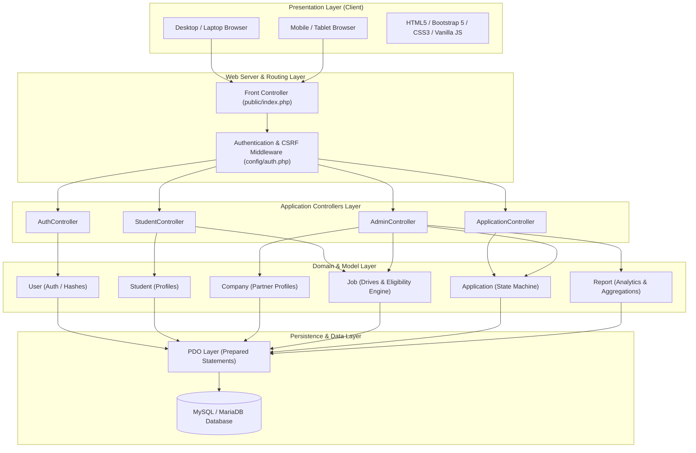
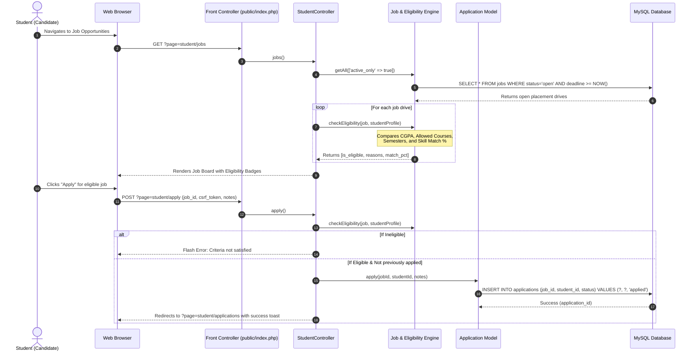
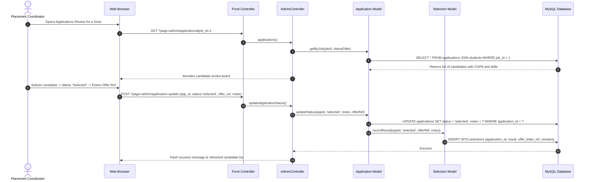

# Campus Recruitment Management System (CRMS)
## System Architecture & Sequence Workflows

This document outlines the layered software architecture, security mechanisms, and end-to-end user workflows of CRMS.

---

### 1. High-Level Tiered Architecture

---

### 2. End-to-End Sequence Workflows

#### Flow A: Student Automated Eligibility Check & Application Submission

#### Flow B: Placement Administrator Shortlisting & Selection Flow

---

### 3. Core Security & Design Principles

1. **Role-Based Access Control (RBAC)**:
   - Evaluated on every controller invocation.
   - `Auth::requireStudent()` ensures administrators cannot unintentionally alter student state.
   - `Auth::requireAdmin()` strictly guards administrative operations (managing companies, editing drives, selecting candidates, exporting CSV reports).

2. **Defense Against SQL Injection**:
   - 100% of database interactions use PDO with parameterized queries and prepared statements (`?` place-holders).
   - PDO emulation of prepared statements is explicitly disabled (`PDO::ATTR_EMULATE_PREPARES => false`).

3. **Cross-Site Request Forgery (CSRF) Tokens**:
   - Cryptographically random 32-byte hexadecimal tokens generated via `random_bytes(32)`.
   - Included in every state-altering `<form>` via `<?= csrfField() ?>`.
   - Verified before processing POST requests using timing-attack resistant `hash_equals()`.

4. **Cross-Site Scripting (XSS) Prevention**:
   - All dynamic output rendered to views is sanitized using `e()` helper (`htmlspecialchars(..., ENT_QUOTES, 'UTF-8')`).

5. **Secure Credential Storage**:
   - Passwords hashed using industry-standard `PASSWORD_BCRYPT` with automated salt management. Plaintext passwords are never persisted.
