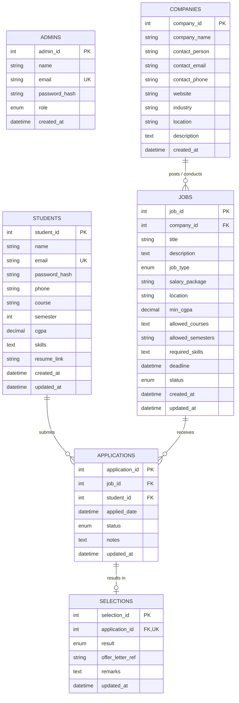

# Campus Recruitment Management System (CRMS)
## Entity-Relationship (ER) Diagram & Data Dictionary

This document outlines the complete relational database design for the Campus Recruitment Management System (CRMS).

---

### 1. Entity-Relationship Diagram (Mermaid)

---

### 2. Relationship Cardinalities & Rules

1. **Company to Job (`1 : N`)**:
   - A partner recruiting company can post multiple placement drives or opportunities.
   - Deleting a company cascades and removes associated job drives (`ON DELETE CASCADE`).

2. **Job to Application (`1 : N`)**:
   - A job posting receives applications from multiple students.
   - Unique constraint `(job_id, student_id)` prevents duplicate applications by the same student.

3. **Student to Application (`1 : N`)**:
   - A registered student can apply to multiple jobs for which they meet automated eligibility requirements.
   - Deleting a student record cascades and cleans up submitted applications.

4. **Application to Selection (`1 : 0..1`)**:
   - Each job application has at most one selection record logging final hiring outcome, offer reference number, and coordinator remarks.
   - Linked via unique foreign key `application_id`.

---

### 3. Data Dictionary

#### Table: `admins`
| Column | Type | Nullable | Key | Default | Description |
| :--- | :--- | :--- | :--- | :--- | :--- |
| `admin_id` | INT | No | PK | AUTO_INCREMENT | Unique identifier for admin/coordinator |
| `name` | VARCHAR(100) | No | | | Full name of administrator |
| `email` | VARCHAR(150) | No | UNIQUE | | Login email address |
| `password_hash` | VARCHAR(255) | No | | | Bcrypt password hash |
| `role` | ENUM | No | | 'coordinator' | 'superadmin' or 'coordinator' |
| `created_at` | DATETIME | Yes | | CURRENT_TIMESTAMP | Account creation timestamp |

#### Table: `students`
| Column | Type | Nullable | Key | Default | Description |
| :--- | :--- | :--- | :--- | :--- | :--- |
| `student_id` | INT | No | PK | AUTO_INCREMENT | Unique identifier for student |
| `name` | VARCHAR(100) | No | | | Full name of student |
| `email` | VARCHAR(150) | No | UNIQUE | | College email address |
| `password_hash` | VARCHAR(255) | No | | | Bcrypt password hash |
| `phone` | VARCHAR(20) | Yes | | NULL | Contact phone number |
| `course` | VARCHAR(100) | No | INDEX | | Degree & branch (e.g. B.Tech CSE) |
| `semester` | TINYINT UNSIGNED | No | | | Current semester (1 to 8) |
| `cgpa` | DECIMAL(3,2) | No | INDEX | 0.00 | Current CGPA (0.00 - 10.00) |
| `skills` | TEXT | Yes | | NULL | Comma-delimited skill list |
| `resume_link` | VARCHAR(255) | Yes | | NULL | Portfolio or resume link |
| `created_at` | DATETIME | Yes | | CURRENT_TIMESTAMP | Registration timestamp |
| `updated_at` | DATETIME | Yes | | ON UPDATE CURRENT_TIMESTAMP | Last profile update |

#### Table: `companies`
| Column | Type | Nullable | Key | Default | Description |
| :--- | :--- | :--- | :--- | :--- | :--- |
| `company_id` | INT | No | PK | AUTO_INCREMENT | Unique identifier for company |
| `company_name` | VARCHAR(150) | No | | | Company name |
| `contact_person`| VARCHAR(100) | Yes | | NULL | HR or campus recruiter name |
| `contact_email` | VARCHAR(150) | Yes | | NULL | Official recruiter email |
| `contact_phone` | VARCHAR(20) | Yes | | NULL | Recruiter phone number |
| `website` | VARCHAR(255) | Yes | | NULL | Corporate URL |
| `industry` | VARCHAR(100) | Yes | | 'Information Technology' | Industry category |
| `location` | VARCHAR(150) | Yes | | NULL | HQ / office location |
| `description` | TEXT | Yes | | NULL | Corporate description |
| `created_at` | DATETIME | Yes | | CURRENT_TIMESTAMP | Record created timestamp |

#### Table: `jobs`
| Column | Type | Nullable | Key | Default | Description |
| :--- | :--- | :--- | :--- | :--- | :--- |
| `job_id` | INT | No | PK | AUTO_INCREMENT | Unique identifier for job drive |
| `company_id` | INT | No | FK | | Partner company offering job |
| `title` | VARCHAR(150) | No | | | Position / job title |
| `description` | TEXT | No | | | Job specifications & roles |
| `job_type` | ENUM | Yes | | 'Full-time' | 'Full-time', 'Internship', 'FTE + Internship' |
| `salary_package`| VARCHAR(100)| Yes | | 'Best in Industry'| CTC or stipend (e.g. 14 LPA) |
| `location` | VARCHAR(150) | Yes | | 'On-site' | Work location |
| `min_cgpa` | DECIMAL(3,2) | No | | 6.00 | Minimum CGPA threshold |
| `allowed_courses`| TEXT | No | | | Allowed degrees ('All' or comma-separated)|
| `allowed_semesters`| VARCHAR(100)| No | | '7,8' | Allowed semesters ('All' or '7,8') |
| `required_skills`| TEXT | Yes | | NULL | Required technical skills |
| `deadline` | DATETIME | No | INDEX | | Application cutoff date & time |
| `status` | ENUM | Yes | INDEX | 'open' | 'open' or 'closed' |
| `created_at` | DATETIME | Yes | | CURRENT_TIMESTAMP | Published timestamp |

#### Table: `applications`
| Column | Type | Nullable | Key | Default | Description |
| :--- | :--- | :--- | :--- | :--- | :--- |
| `application_id`| INT | No | PK | AUTO_INCREMENT | Application identifier |
| `job_id` | INT | No | FK | | Associated job drive |
| `student_id` | INT | No | FK | | Applying student |
| `applied_date` | DATETIME | Yes | | CURRENT_TIMESTAMP | Submission timestamp |
| `status` | ENUM | Yes | INDEX | 'applied' | 'applied', 'under_review', 'shortlisted', 'selected', 'rejected' |
| `notes` | TEXT | Yes | | NULL | Candidate notes or feedback |
| `updated_at` | DATETIME | Yes | | ON UPDATE CURRENT_TIMESTAMP | Status update timestamp |

#### Table: `selections`
| Column | Type | Nullable | Key | Default | Description |
| :--- | :--- | :--- | :--- | :--- | :--- |
| `selection_id` | INT | No | PK | AUTO_INCREMENT | Selection record identifier |
| `application_id`| INT | No | FK, UNIQUE| | Linked application |
| `result` | ENUM | No | | 'selected' | 'selected' or 'rejected' |
| `offer_letter_ref`| VARCHAR(100)| Yes | | NULL | Official offer letter ID |
| `remarks` | TEXT | Yes | | NULL | Offer terms & feedback |
| `updated_at` | DATETIME | Yes | | ON UPDATE CURRENT_TIMESTAMP | Selection log timestamp |
